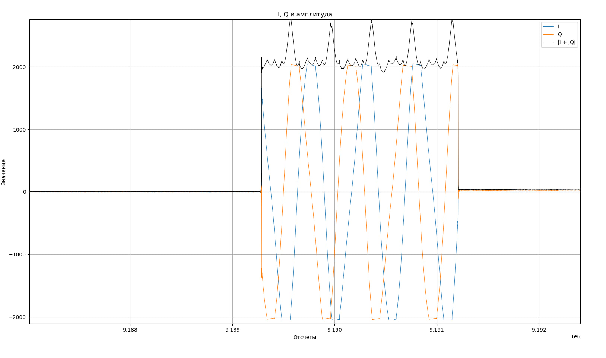

# Отчёт по лабораторной работе

**Тема:** Две Adalm Pluto SDR: прямой (downlink) и обратный (uplink) каналы

## Цель работы
Организовать радиоканал между двумя Adalm Pluto SDR с использованием SoapySDR и временных меток (timestamp). Реализовать прямой (downlink) и обратный (uplink) каналы на разных несущих частотах, передать прямоугольные импульсы и получить их на приёмной стороне с записью RX-буфера в файл и визуализацией амплитуды.

## Краткое содержание
Используются две Adalm Pluto, подключённые к одному компьютеру по USB. Одна программа `main` запускается в двух консолях: в одной SDR работает как передатчик, в другой как приёмник. Направление связи задаётся каналом:

| Канал | Частота | Направление |
|-------|---------|-------------|
| `down` (downlink, прямой) | 433 МГц | SDR №1 → SDR №2 |
| `up` (uplink, обратный) | 434 МГц | SDR №2 → SDR №1 |

Каналы разнесены на 1 МГц. При частоте дискретизации 1 МГц полоса приёма составляет примерно ±0.5 МГц, поэтому соседний канал в неё не попадает. В каждый момент времени работает один канал, для смены направления программы перезапускаются с другими аргументами.

Передатчику нужен собственный RX-поток: из него берутся временные метки FPGA, относительно которых планируется отправка TX-буферов. Этот RX настраивается на частоту другого канала, принятые им сэмплы не сохраняются.

### Основные этапы
1. Установка SoapySDR, libiio, libad9361, SoapyPlutoSDR (ветка sdr_gadget_timestamping).
2. Написание C++ программы с использованием SoapySDR API:
   - Инициализация устройства (driver=plutosdr, uri=usb:..., direct=1, timestamp_every=1920)
   - Выбор режима (`tx`/`rx`), устройства (URI) и канала (`down`/`up`) из аргументов командной строки
   - Настройка Sample Rate = 1 МГц, Frequency = 433 или 434 МГц
   - Gain RX = 20 дБ, TX = 89 (ослабление 0 дБ, драйвер пересчитывает как `gain − 89`)
   - Создание потоков (SOAPY_SDR_CS16)
3. Передатчик в цикле:
   - Чтение RX-буфера своей SDR и получение timestamp
   - Отправка TX-буфера с меткой времени `timestamp + 4 мс` (флаг `SOAPY_SDR_HAS_TIME`)
   - Чётные буферы содержат сигнал (I = Q = 1500 << 4), нечётные — нули
4. Приёмник в цикле:
   - Чтение RX-буфера и получение timestamp
   - Запись принятых сэмплов в `rx_down.pcm` или `rx_up.pcm`
5. Остановка обеих программ по Ctrl+C с закрытием файла и потоков.
6. Визуализация I, Q и амплитуды |I + jQ| с помощью Python-скрипта `read.py`.

### Ключевые параметры программы
| Параметр | Значение |
|----------|----------|
| Sample Rate | 1 МГц |
| Частота downlink | 433 МГц |
| Частота uplink | 434 МГц |
| Формат сэмплов | CS16 (int16 I/Q) |
| Размер буфера | 1920 отсчётов (timestamp_every) |
| Задержка отправки TX | +4 мс относительно RX timestamp |
| Длительность импульса | 1920 отсчётов (1.92 мс) |
| Период импульсов | 3840 отсчётов (3.84 мс) |
| Gain RX / TX | 20 / 89 |
| Итераций | до остановки по Ctrl+C |

### Запуск
```bash
# downlink: SDR №1 передаёт, SDR №2 принимает на 433 МГц
./main tx usb:1.3.5 down
./main rx usb:1.5.5 down

# uplink: SDR №2 передаёт, SDR №1 принимает на 434 МГц
./main tx usb:1.5.5 up
./main rx usb:1.3.5 up

# визуализация
python3 read.py down
python3 read.py up
```
URI устройств определяются командой `SoapySDRUtil --find`.

## Результаты


**Downlink (433 МГц):**



Ожидаемый результат: амплитуда |I + jQ| имеет вид прямоугольных импульсов длительностью 1920 отсчётов, разделённых паузами такой же длины. В паузах остаётся только шум приёмника.

## Вывод

Реализована связь между двумя Adalm Pluto SDR по прямому и обратному каналам на частотах 433 и 434 МГц. Отправка TX-буферов планируется по временным меткам FPGA, что позволяет формировать импульсы заданной длительности с точной привязкой ко времени.
